# credit-scoring-model

Автоматизированный пайплайн для PD-модели: вероятность дефолта клиента по кредитной карте в следующем месяце. Данные: Default of Credit Card Clients Dataset (UCI), 30000 клиентов, 22.1% дефолтов, целевая переменная `default.payment.next.month`.

Пайплайн: валидация данных (Great Expectations), очистка и сплит, признаки внутри sklearn Pipeline, подбор гиперпараметров (RandomizedSearchCV), трекинг в MLflow, версии данных и модели в DVC, FastAPI в Docker, проверка дрифта по PSI, CI в GitHub Actions.

## Структура

```
data/raw/            исходный CSV (под DVC)
data/processed/      train.csv и test.csv после стадии prepare (под DVC)
data/expectations/   выгрузка набора правил Great Expectations
models/              обученная модель (под DVC)
reports/             ROC-кривая, отчёты о дрифте
notebooks/           EDA
src/data/            make_dataset.py (очистка, сплит), validation.py (GE)
src/features/        build_features.py (признаки)
src/models/          pipeline.py, train.py, evaluate.py, predict.py
src/api/             app.py (FastAPI)
src/monitoring/      drift.py (PSI), simulate_drift.py
tests/               pytest, tests/data/sample.csv (600 строк для тестов и CI)
scripts/             run_docker.sh
```

## Установка

Python 3.14 (версия в Dockerfile и в CI та же).

```
python -m venv .venv
source .venv/bin/activate      # Windows: .venv\Scripts\activate
pip install -r requirements-dev.txt
```

Модель сохраняется pickle-ом, поэтому версия scikit-learn при обучении и в Docker-образе должна совпадать. Версии в `requirements.txt` зафиксированы по `pip freeze`.

## DVC

```
git init
dvc init
dvc add data/raw/UCI_Credit_Card.csv
dvc remote add -d local ../dvc-storage
git add .dvc data/raw/UCI_Credit_Card.csv.dvc data/raw/.gitignore
dvc repro
dvc push
```

`dvc repro` выполняет две стадии из `dvc.yaml`: `prepare` (валидация, очистка, сплит) и `train` (6 экспериментов, лучшая модель в `models/credit_default_model.pkl`, метрики в `metrics.json`, ROC в `reports/roc_curve.png`). Метрики: `dvc metrics show`.

## Данные

Файл `data/raw/UCI_Credit_Card.csv` не хранится в git (версионируется DVC, в репозитории лежит `UCI_Credit_Card.csv.dvc`). Скачайте датасет Default of Credit Card Clients с UCI Machine Learning Repository и положите в `data/raw/`. Хэш файла совпадёт с записью в `.dvc`, после этого работает `dvc repro`. Для тестов и CI используется выборка `tests/data/sample.csv` (600 строк).

## Валидация данных

```
python -m src.data.validation data/raw/UCI_Credit_Card.csv --dump-suite data/expectations/credit_data_suite.json
```

Код выхода 1, если нарушено хотя бы одно правило. Тесты на аномалии: `pytest tests/test_validation.py`. В CI валидация идёт на `tests/data/sample.csv`.

## MLflow

```
mlflow ui --backend-store-uri sqlite:///mlflow.db
```

Запускайте из корня репозитория после `dvc repro`: файл `mlflow.db` создаётся при обучении и читается из текущей папки. Откройте http://localhost:5000, эксперимент `Credit_Default_Prediction`. Каждый запуск логирует параметры, `cv_roc_auc`, `threshold`, `test_roc_auc`, `test_precision`, `test_recall`, `test_f1`, ROC-кривую и модель. Лучшая модель выбирается по `cv_roc_auc` на train, порог классификации по out-of-fold предсказаниям train, test не участвует в выборе.

## Тесты и стиль

```
pytest
black --check .
flake8
```

## API и Docker

После `dvc repro` или `dvc pull` в `models/` лежит модель.

```
bash scripts/run_docker.sh
```

Скрипт собирает образ, запускает контейнер на порту 8000 и отправляет пример из `tests/data/example_request.json` на `POST /predict`. Ответ: `default_prediction` (0 или 1) и `default_probability`. Документация: http://localhost:8000/docs.

Без Docker: `uvicorn src.api.app:app --port 8000`.

## Мониторинг дрифта (симуляция)

```
python -m src.monitoring.simulate_drift --n 500 --report reports/drift_report_baseline.json
python -m src.monitoring.simulate_drift --n 500 --shift --report reports/drift_report_shift.json
```

Скрипт берёт 500 строк test, отправляет их в API и считает PSI по `PAY_0`, `LIMIT_BAL`, `AGE`, `BILL_AMT1`, `PAY_AMT1` и по предсказанной вероятности относительно train. Пороги: PSI < 0.1 стабильно, 0.1-0.25 умеренный сдвиг, от 0.25 значимый. Флаг `--shift` искусственно сдвигает `PAY_0` на единицу и режет `LIMIT_BAL` на 30%.

## Результаты

Метрики на отложенной выборке (20% данных, 6000 клиентов). Порог классификации подобран по out-of-fold предсказаниям train, лучшая модель выбрана по `cv_roc_auc`.

| Эксперимент | cv_roc_auc | test_roc_auc | test_precision | test_recall | test_f1 |
|---|---|---|---|---|---|
| logreg_l2 | 0.7597 | 0.7472 | 0.478 | 0.558 | 0.515 |
| rf_shallow | 0.7855 | 0.7794 | 0.531 | 0.548 | 0.540 |
| rf_deep | 0.7855 | 0.7767 | 0.502 | 0.579 | 0.537 |
| gb_base | 0.7859 | 0.7812 | 0.486 | 0.605 | 0.539 |
| hgb | 0.7866 | 0.7822 | 0.504 | 0.596 | 0.546 |
| hgb_regularized | 0.7870 | 0.7822 | 0.505 | 0.594 | 0.546 |

Итоговая модель: `hgb_regularized`, порог 0.258.

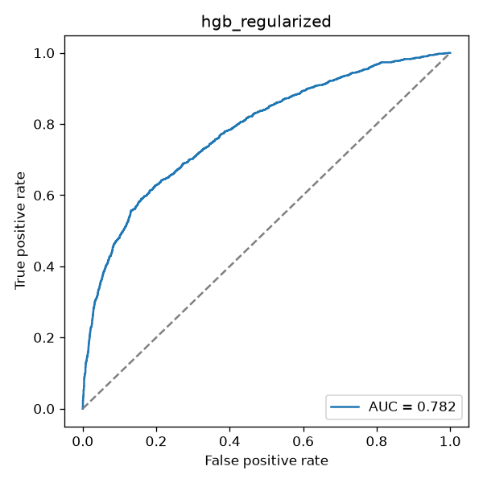

### Анализ экспериментов (MLflow)

Деревянные модели достигают `cv_roc_auc` 0.786-0.787 и test ROC-AUC 0.777-0.782, логистическая регрессия отстаёт (0.760 и 0.747). Различия между деревьями находятся в пределах 0.0015 AUC по `cv_roc_auc`. Поиск выбирал неглубокие деревья с сильной регуляризацией, возможно, из-за шумности данных. Разница между CV и test у лучших моделей около 0.005 (`hgb`, `hgb_regularized`), у `rf_deep` 0.009, у `logreg_l2` 0.0125: сильного переобучения нет. `HistGradientBoosting` (около 20 с) в несколько раз быстрее `GradientBoosting` (2.5 мин) при том же качестве.

Разница в precision и recall между деревьями в основном отражает положение порога на кривой precision-recall, поэтому для сравнения моделей надёжнее AUC и F1. Порог логистической регрессии (0.563) выше остальных (0.245-0.306) из-за `class_weight=balanced`.

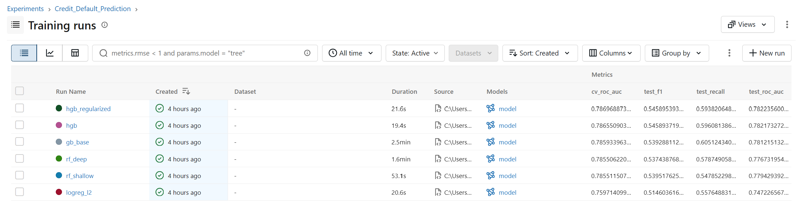
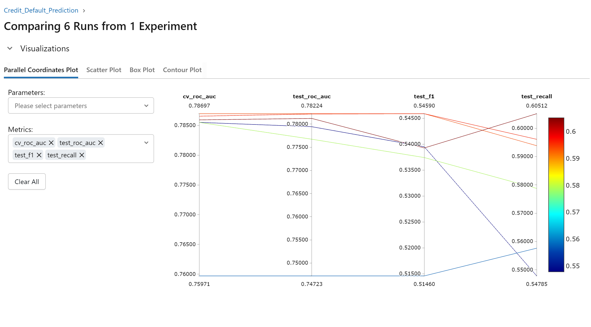
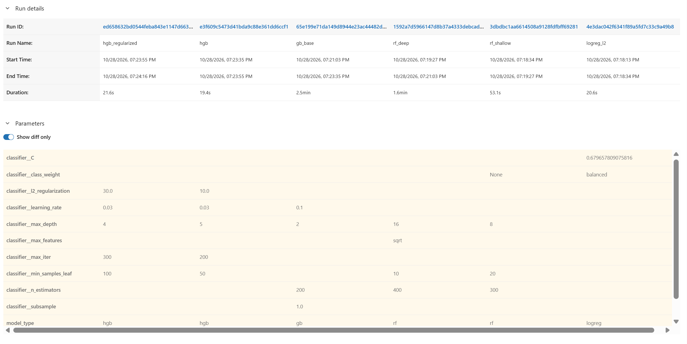

### API и Docker

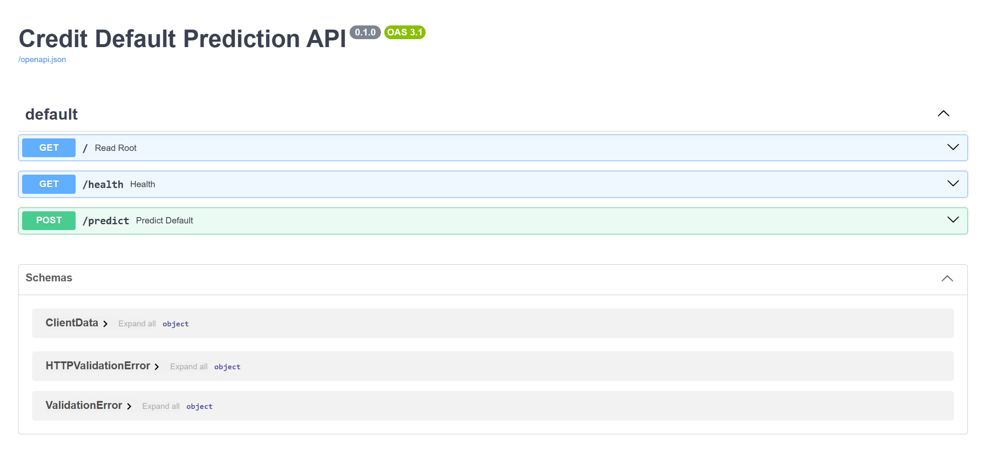
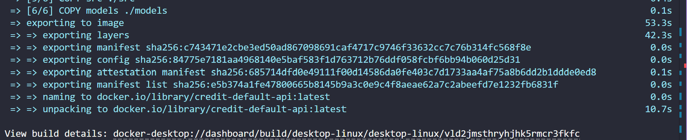
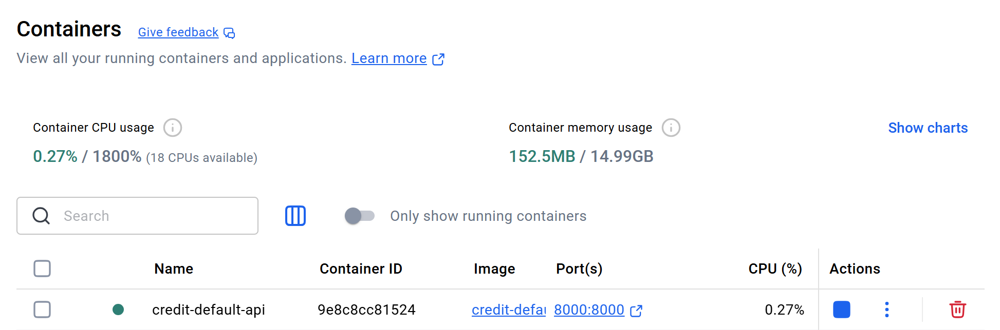
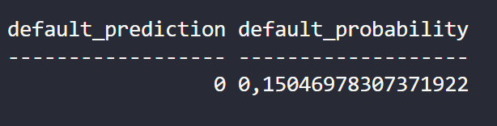

### Мониторинг дрифта

Настоящего дрифта в данных нет: эталон (train) и входящие данные (test) получены одним сплитом. Сдвиг в режиме `--shift` внесён искусственно (`PAY_0` плюс единица, `LIMIT_BAL` умножен на 0.7), поэтому эксперимент проверяет детектор. Без сдвига все PSI ниже 0.1. Со сдвигом детектор сработал по `PAY_0`, `LIMIT_BAL` и предсказанной вероятности, а несдвинутые признаки остались стабильными. Отчёты: `reports/drift_report_baseline.json`, `reports/drift_report_shift.json`.

| Признак | PSI без сдвига | PSI со сдвигом |
|---|---|---|
| PAY_0 | 0.0075 | 2.0502 |
| LIMIT_BAL | 0.0214 | 1.5514 |
| AGE | 0.0258 | 0.0258 |
| BILL_AMT1 | 0.0125 | 0.0125 |
| PAY_AMT1 | 0.0209 | 0.0209 |
| predicted_probability | 0.0394 | 0.4925 |

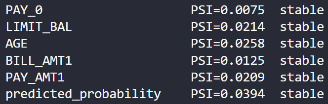
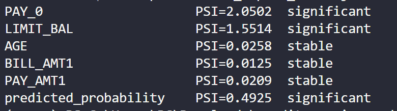

### CI

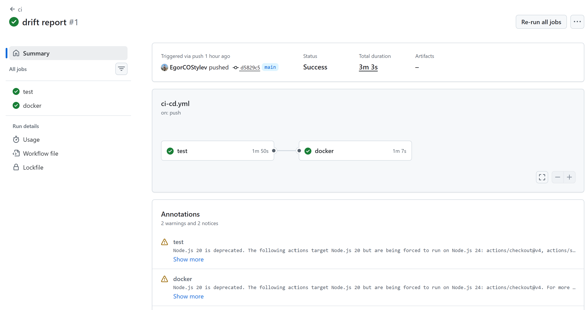

### Ограничения

В `MARRIAGE` код 0 (54 строки) свёрнут в код 3 как недокументированный, хотя доля дефолтов у этих групп отличается (9% и 26%). Влияние на метрики, вероятно, невелико, отдельно не проверялось.
